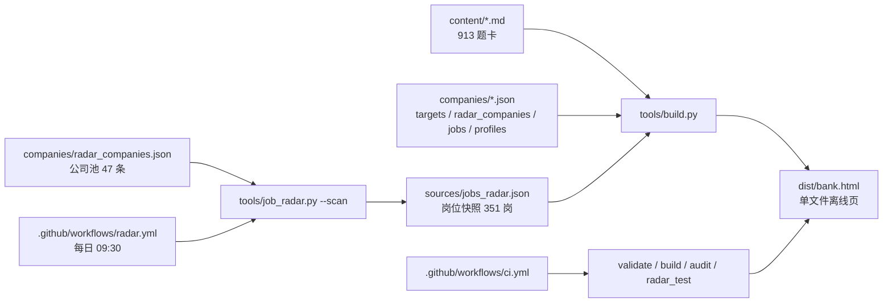

# 架构说明 · CareerOS 求职功能台

> 单一真源：题目正文只在 `content/**/*.md`，结构化数据只在 `companies/` 与 `sources/*.json`，
> 网页 `dist/bank.html` 一律由 `tools/build.py` 生成。禁止手改成品 HTML。

## 一、分层与职责

| 层 | 位置 | 职责 | 产出 / 消费者 |
|---|---|---|---|
| 内容层 | `content/`（11 模块） | 一题一 `.md` + YAML frontmatter，口述稿体答案、手写 SVG 插图 | `tools/build.py` 读取 |
| 写卡层 | `tools/cards/*.cards`、`tools/apply_cards.py` | 纯文本写答案，避开 Python 中文引号转义 | 回灌到 `content/` |
| 校验层 | `tools/validate.py`、`tools/audit.py` | 字段/号段/小节/ID 唯一；重复与来源审计 | CI 门禁 |
| 数据层 | `companies/*.json`、`sources/*.json` | 目标公司池、雷达公司池、岗位模板、种子岗位、雷达快照 | 构建时注入 HTML |
| 采集层 | `tools/job_radar.py`、`tools/nc_collect.py` | 官方招聘门户低频增量扫描；牛客面经/真题增量 | `sources/jobs_radar.json` 等 |
| 构建层 | `tools/build.py` | 把 913 题卡 + 数据对象注入 `PAGE` 模板，产出单文件离线页 | `dist/bank.html`（约 5.3 MB） |
| 表现层 | `dist/bank.html` | 6 个视图、筛选、复习、训练、岗位匹配、公司总览；状态存 localStorage | 双击即开，无需服务端 |
| 自动化层 | `.github/workflows/radar.yml` / `ci.yml` | 每日 09:30 扫描；push 时校验+构建+审计+雷达逻辑回归 | 有 diff 才提交 |
| 测试层 | `tools/ui_test.py`、`tools/radar_test.py`、`tools/rep_test.py` | Edge/Playwright 冒烟、纯逻辑回归、报告回归 | 本机验收 |

## 二、数据流

用户浏览器里的自评、错题、收藏、忽略全部写 localStorage，**不回写仓库**；换设备用题库页「备份↓」导出 JSON。

## 三、三个「池」必须分开理解

| 对象 | 文件 | 数量（2026-11-10） | 含义 |
|---|---|---|---|
| 目标公司池 | `companies/targets.json` | 128 家 | 题库公司/岗位族索引口径，按 JD 推导，**不是真实考题** |
| 雷达公司池 | `companies/radar_companies.json` | 47 条 / 45 家去重 | 招聘入口登记表；`enabled=true` 且带 `source` 的 9 条才实际扫描 |
| 岗位快照 | `sources/jobs_radar.json` | 351 岗 | 官方门户扫到的岗位，带状态机与招聘性质分类 |

「公司」视图把前两者按名称合并（别名表 `NAME_ALIAS` 处理「小鹏集团 → 小鹏」），
同名去重后 152 家，并把第三者的岗位按公司聚合展示。

## 四、前端视图（hash 路由）

| hash | 视图 | 主要职责 |
|---|---|---|
| `#home` | 首页 | 数据卡、快速入口、今日任务、岗位进度、雷达可信行、公司/岗位总览入口 |
| `#bank` | 题库 | 全文搜索、chips/pills 筛选、答案折叠、自评 1~4、错题、备份 |
| `#train` | 训练 | 模拟面试、项目连环问、专项训练入口 |
| `#jobs` | 岗位 | 收藏岗位 + JD 技能匹配三维度 + 雷达待处理新发现（最多 40 条） |
| `#comp` | 公司（V1.8） | **全部公司 + 全部岗位**，按校招/实习/社招分组，含已收藏/已忽略 |
| `#rep` | 分析 | 近 8 周节奏、模块掌握度、薄弱题、下一步建议 |

localStorage 键：`ib_review_v1`（自评→间隔复习）、`ib_wrong_v1`、`ib_hist_v1`（训练历史）、
`ib_jobs_v1`（人工登记 + 雷达收藏转正）、`ib_jobs_dismiss_v1`（忽略，按 job_key）。

## 五、关键不变量

1. `job_key = 公司 : 来源岗位ID : 归一化城市 : 批次`；收藏/忽略/下线判定全部按 key 隔离。
2. 采集失败 ≠ 岗位下线；连续 2 次成功扫描未见才标 `suspect`。
3. 招聘性质分类的证据优先级不可颠倒：岗位标题 > 来源批次标签 > 校园招聘入口推定。
4. 届别三态独立展示：覆盖（题库有没有）/ 掌握（自评）/ 资格（届别硬性条件）不互相抵消。
5. 合规：不登录、不绕验证码、不提交 Cookie/Token/简历，只读公开职位列表页。

## 六、版本轴

`CHANGELOG.md` 的 `v1.x` 是**题库内容版本**；代码注释里的 `CareerOS V1.5~V1.8` 是**功能台版本**，
两套编号独立，不要互相套用。本轮为功能台 V1.8（全部公司总览 + 招聘性质分类）。
