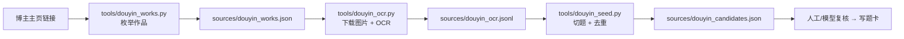

# 抖音图文 → 题库 流水线

把「秋招博主」的**图文作品**里每张图上的文字自动读出来，切成面试题，去重后进 `content/`。

三段脚本，各管一段，可以单独跑、单独重跑：



## 为什么要多写两个脚本

`douyin-scraper` skill 只吃**单个作品链接**（`/note/` `/video/` `/slides/`），能下载图文作品的所有图片，
但**不能列出一个博主的所有作品**。所以补了 `douyin_works.py` 做枚举。

枚举方式不是自己拼接口（抖音的 `a_bogus` 签名会失效），而是**在浏览器里打开主页、听抖音自己发起的
作品列表请求**——我们只在旁边读响应，页面照常正常加载，不伪造请求、不改参数。

## 用法

```bash
PY="/c/Users/DOUDOU/.workbuddy/binaries/python/envs/default/Scripts/python"   # 带 playwright 的解释器

# 1) 枚举作品（公开号一般不需要登录）
"$PY" tools/douyin_works.py "https://www.douyin.com/user/<sec_uid>" --max 200

# 1b) 若页面要求登录：先扫码登录一次，登录态会存到 _cache/douyin_profile/storage.json
"$PY" tools/douyin_works.py "<主页链接>" --login

# 2) 下载图片并 OCR
"$PY" tools/douyin_ocr.py --limit 30            # 先小批量试
"$PY" tools/douyin_ocr.py --engine tesseract    # 指定引擎

# 3) 切题 + 与现有题库去重（只出候选清单，不写题卡）
"$PY" tools/douyin_seed.py --dry
```

## OCR 引擎

| 引擎 | 状态 | 说明 |
|---|---|---|
| **tesseract 5.5 + chi_sim** | ✅ 已装（语言包需手动补） | `D:\msys64\ucrt64\bin\tesseract.EXE`；chi_sim.traineddata 已放到 `D:\msys64\ucrt64\share\tessdata\` |
| RapidOCR（PP-OCR 中文） | ⏳ 可选，装了自动优先 | 逐行置信度更高、艺术字更稳 |

补语言包（换机器时需要）：

```bash
curl -L -o /d/msys64/ucrt64/share/tessdata/chi_sim.traineddata \
  https://github.com/tesseract-ocr/tessdata_fast/raw/main/chi_sim.traineddata
```

## 实测准确率（2026-11-23，真实抖音图）

以「校招博主Alex」公开作品为样本：

| 图片类型 | 例子 | tesseract 表现 |
|---|---|---|
| 表格型（大字、留白多） | 「2024 届名企校招信息表」 | **约 95%**，只错「科大讯飞→科大讯」、日期前多引号 |
| 纯文字卡 | 「这些公司秋招岗位刚刚放出！」 | 约 90%，个别字错（划罗由放出→刚刚放出） |
| 营销拼贴/密排 | 9 张小图拼接 + 装饰字 | **差**，整段乱码，需要人工或换 RapidOCR |

结论：**题目类图片（单栏、大字）基本可用**；拼贴类必须走人工或换引擎。
每页都会记 `conf` 置信度，低置信页在清单里会标出来，可以只复核这些。

## OCR 后处理（已实现的坑）

- `”` → `？`（中文问号被识别成右引号，实测高频）
- `C+ +` → `C++`（加号被拆开）
- 折行合并：中文直接相接、英文之间补空格；**「问：」「答：」行与项目符号行不参与合并**（否则整页连成一行）
- 水印/营销噪声过滤：关注我、点赞收藏、扫码、第 N 期、#话题 等

## 切题规则

支持三种版式：编号清单（`1. 题`）、问答配对（`问：… / 答：…`）、每行一题。
质量筛：长度 6~60、必须含疑问词或问号、滤掉营销语。
去重：与现有 1033 道题做 Dice 相似度，≥0.62 直接判重；同批次内 0.85 判重。
候选清单会带上「近似题号 + 相似度」，方便快速扫一眼就知道是新题还是老题。

## 合规边界

- 只读公开页面、低频、**不批量再分发原图**，图片不落仓库（`_cache/` 已在 `.gitignore`）；
- 题卡里只保留**题目文字 + 原作品链接 + 作者署名**，标注 `source_type: douyin`；
- 著作权属原作者，入库仅作个人复习使用；若要公开发布，建议只保留**题目本身**（事实性内容），
  不复制其原创排版、答案长文或图片；
- 抖音用户协议对自动化访问有限制，脚本已按「不登录账号、不点赞评论、不刷量」的低扰动方式实现。

## 当前状态

- 三个脚本已就位并跑通（枚举 → OCR → 切题去重）；
- `source_type: douyin` 已在 `tools/validate.py` 登记；
- **还差博主主页链接**：给我 `https://www.douyin.com/user/...` 就能跑全量。
