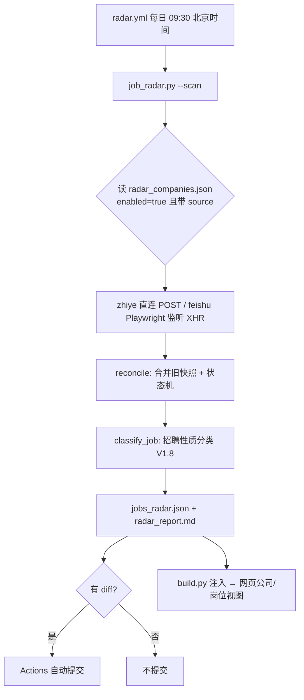

# 执行流程 · 从输入到输出

## 一、日常：只改内容，再构建

```bash
cd D:/工程/面试题库

# 1) 写题：直接改 content/<模块>/Q-xxxx-*.md；批量答案写 tools/cards/*.cards 后回灌
python tools/apply_cards.py tools/cards/py_a.cards

# 2) 校验（字段 / 号段 / 小节 / ID 唯一 / 草稿不得空壳）
python tools/validate.py

# 3) 生成单文件离线页
python tools/build.py

# 4) 体检 + 逻辑回归 + 浏览器回归
python tools/audit.py
python tools/radar_test.py
python tools/ui_test.py

# 5) 推送（本机 HTTPS 推 GitHub 不通，一律 SSH）
git add -A && git commit -m "..." && git push origin main
```

`build.py` 依次注入 `__DATA__ / __TARGETS__ / __PROFILES__ / __JOBS__ / __RADAR__ / __POOL__`
到 `PAGE` 模板，输出 `dist/bank.html`；任何占位符没被替换都会在页面里露出来，构建后应检查。

## 二、岗位雷达：机器每天跑，人只做判断



人工介入点：

1. **新增公司** → 在 `companies/radar_companies.json` 加条目，填 `tier / category / career_url / ats_type`；
   有适配器（zhiye/feishu）且核验过入口后设 `enabled=true` 与 `source`，否则保持 `false`（网页标「未接入」）。
2. **离线重分类**（不联网、不改岗位内容与状态机）：
   ```bash
   python tools/job_radar.py --reclassify
   ```
   适用于分类规则升级、或历史快照缺 `job_class` 字段时补齐。
3. **收藏 / 忽略**：网页 `#jobs` 的雷达折叠区只列**待处理新发现（最多 40 条）**；
   点「⭐ 收藏转正」写入 `ib_jobs_v1`，点「忽略」写入 `ib_jobs_dismiss_v1`。
   **这些岗位不会消失**：`#comp` 视图仍完整列出，用「岗位状态」chips 可单独筛出已收藏 / 已忽略。

## 三、用户侧使用路径（V1.8 新增）

1. 打开 `dist/bank.html` → 首页「🛰 岗位雷达」行末尾点「🏢 查看全部公司 / 全部岗位」，
   或直接点顶部「🏢 公司」标签（也可 `#comp` 直达）。
2. **看全部公司**：公司表默认列出两池去重后的全部 152 家；「公司」chips 可切
   `雷达池 / 已接入 / 未接入 / 仅目标池`；点任意公司行 → 搜索框自动填该公司名，只看该公司的岗位。
3. **看分类**：岗位表按 `实习 / 校招 / 社招 / 未标明` 分组，每行带性质徽标、
   批次届别、判定依据（标题明确 / 批次标签 / 入口推定）、状态与处理状态、JD 原文链接。
4. **看已处理的岗位**：「岗位状态」chips 选 `已收藏 / 已忽略 / 待处理`；清空搜索恢复全部。
5. **投递前核实**：依据是「校园招聘入口推定」的岗位，只说明它挂在校园招聘入口下，
   必须点 JD 原文确认是校招还是实习、是否限届别。

## 四、复习与训练闭环

`自评 1~4` → `REV_DAYS = {1:1, 2:3, 3:7, 4:21}` 天间隔复习 → 到期题进首页「今日该复习」；
1~2 分同时进错题本；自评与训练写 `ib_hist_v1`，供分析视图出近 8 周节奏与模块掌握度。
语义：1 不知道答案 / 2 知道但讲不清 / 3 能独立解释 / 4 能应对追问与实现。

## 五、验收清单（每次改动后）

- [ ] `validate.py` 913 张全通过、`audit.py` 无新增未复核重复
- [ ] `build.py` 生成 `dist/bank.html`，题数 913、已答 913
- [ ] `radar_test.py` 22 项（状态机 + 分类）、`rep_test.py`、`ui_test.py` 47 项全通过
- [ ] 浏览器无 JS 运行时错误（ui_test 已自动捕获 pageerror 并断言）
- [ ] CI 四个步骤（validate / build / audit / radar_test）在 GitHub Actions 通过
- [ ] 推送用 SSH：`git remote -v` 应为 `git@github.com:DOURENCHI/interview-bank.git`
